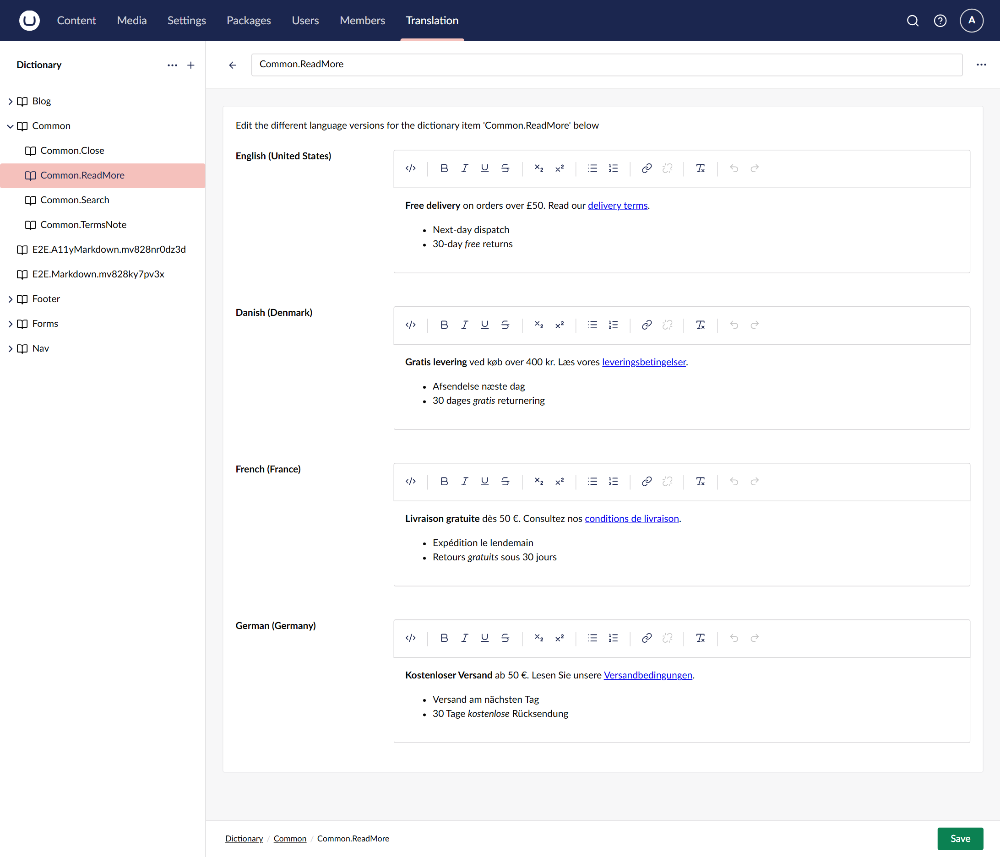
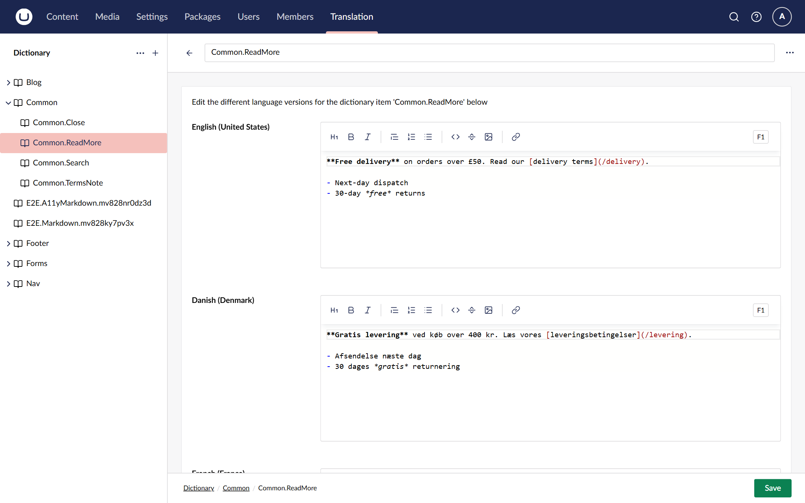

# Umbraco Rich Dictionary

Edit Umbraco dictionary values with a rich text (Tiptap) or Markdown editor instead of a plain
textarea. The package drops into Umbraco's own Translation section: install it and every
dictionary item opens in Umbraco's rich text editor, with no configuration and no change to where
values are stored. Format copy for buttons, footers and banners without writing HTML by hand,
render it on the site with one helper call, or switch the whole site to Markdown.

[](https://www.nuget.org/packages/Umbraco.Community.RichDictionary)
[](https://github.com/worm-brain/Umbraco.RichDictionary/actions/workflows/ci.yml)
[](LICENSE)



## Contents

- [Features](#features)
- [A quick tour](#a-quick-tour)
- [Install](#install)
- [Quick start](#quick-start)
- [Configure](#configure)
- [Compatibility](#compatibility)
- [Documentation](#documentation)
- [Contributing, security and licence](#contributing-security-and-licence)

## Features

**Edit dictionary values with a real editor**

- **Umbraco's own rich text editor** for each language, with a toolbar for short copy: bold,
  italic, lists, links and source view. Use the buttons of one of your rich text data types
  instead with one setting. [Customise the toolbar](docs/how-to/customise-the-toolbar.md)
- **Or Markdown.** One setting gives each language Umbraco's Markdown editor, and values are
  stored as Markdown. [Choose the editor mode](docs/how-to/choose-the-editor-mode.md)
- **Your existing values open as they are.** Plain-text values saved before the package was
  installed show up as paragraphs, with their line breaks. Nothing is migrated or rewritten.
- **Values in the other format are flagged.** After a mode change, the editor warns under a value
  that looks like it was saved in the other mode's format.

**Render them on the site**

- **One helper call** in a view renders a value as HTML: `@Umbraco.GetDictionaryHtml("Footer.Address")`,
  or `GetDictionaryInlineHtml` inside a link or a button. [Render values as HTML](docs/how-to/render-values-as-html.md)
- **Outside views**, inject `IDictionaryHtmlConverter` into a view component, a controller or an
  email template.
- **Sanitised like rich text.** Output goes through Umbraco's `IHtmlSanitizer`, so a site that
  registers one gets dictionary HTML sanitised too. [Sanitise the output](docs/how-to/sanitise-the-output.md)

**Fits the Translation section you already have**

- **Only the edit screen changes.** The tree, create, move, delete, import, export, search and
  permissions stay as Umbraco ships them. [What the package changes](docs/explanation/what-the-package-changes.md)
- **Translators with some languages can save.** The stock editor sends every language, so Umbraco
  refuses the save; the package sends only the languages the user may edit.
- **Tools see the format.** The package declares whether values hold HTML or Markdown to
  Management API clients such as the Umbraco CLI. [Management API](docs/reference/management-api.md)
- **Uninstalls cleanly.** Remove the package and the stock editor comes back, with nothing in the
  database to clean up. [Uninstall the package](docs/how-to/uninstall.md)

## A quick tour

**Rte mode**, the default: each language gets Umbraco's Tiptap rich text editor, as in the
picture above. Values are stored as HTML.

**Markdown mode**: each language gets Umbraco's Markdown editor. Values are stored as Markdown.



## Install

The package comes in one line per Umbraco major: `17.x` versions for Umbraco 17 and `18.x`
versions for Umbraco 18. Pick the line that matches your site:

```sh
# Umbraco 17
dotnet add package Umbraco.Community.RichDictionary --version "17.*"

# Umbraco 18
dotnet add package Umbraco.Community.RichDictionary --version "18.*"
```

Without `--version`, `dotnet add package` picks the newest version overall, which is the `18.x`
line. With central package management, NuGet does not accept a floating version: use the newest
version of your line listed on [NuGet](https://www.nuget.org/packages/Umbraco.Community.RichDictionary).

## Quick start

1. Install the package and restart the site.
2. Sign in to the backoffice and open **Translation**.
3. Open a dictionary item. Each language now has a rich text editor; existing values show up in
   it as paragraphs.
4. In a view, render the value as HTML:

   ```cshtml
   <address>@Umbraco.GetDictionaryHtml("Footer.Address")</address>
   ```

The [tutorial](docs/tutorials/write-and-render-your-first-value.md) walks through it.

## Configure

Everything is optional and lives under `RichDictionary` in `appsettings.json`:

```json
{
  "RichDictionary": {
    "EditorMode": "Rte",
    "RichTextDataType": "Dictionary Rich Text"
  }
}
```

`EditorMode` is `Rte` (the default) or `Markdown`; choose it once per site, before editors start
saving values. The [configuration reference](docs/reference/configuration.md) lists every setting
and its default.

## Compatibility

| Umbraco | Package line | .NET |
| --- | --- | --- |
| 17.x | `17.*` | 10 |
| 18.x | `18.*` | 10 |

Each line installs on every release of its major, from 17.0.0 and 18.0.0. Umbraco 16 and earlier
are not supported.

## Documentation

The full documentation is in [`docs/`](docs/index.md):

- **Tutorial:** [write and render your first rich value](docs/tutorials/write-and-render-your-first-value.md)
- **How-to guides:** [choose the editor mode](docs/how-to/choose-the-editor-mode.md),
  [customise the toolbar](docs/how-to/customise-the-toolbar.md),
  [render values as HTML](docs/how-to/render-values-as-html.md),
  [sanitise the output](docs/how-to/sanitise-the-output.md) and
  [uninstall the package](docs/how-to/uninstall.md)
- **Reference:** [configuration](docs/reference/configuration.md),
  [HTML helpers](docs/reference/html-helpers.md) and the
  [Management API](docs/reference/management-api.md)
- **Explanation:** [what the package changes](docs/explanation/what-the-package-changes.md) and
  [how values are converted](docs/explanation/how-values-are-converted.md)

## Contributing, security and licence

- [CONTRIBUTING.md](CONTRIBUTING.md) explains how to build both Umbraco majors and run the tests.
- [SECURITY.md](SECURITY.md) explains how to report a vulnerability privately.
- [CHANGELOG.md](CHANGELOG.md) lists every user-visible change.
- Licensed under the [MIT licence](LICENSE).
